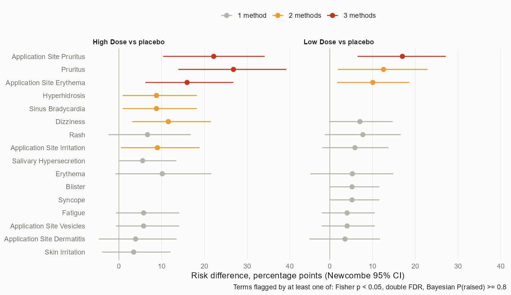

# CDISC pilot study: ADaM with admiral, estimands and reference-based imputation

A regulatory analysis of a clinical trial runs from raw SDTM domains to analysis datasets, from a statistical analysis plan to an estimand, and from a primary model to sensitivity analyses that ask how much the answer depends on what is assumed about patients who stop treatment. This project does that end to end in R on the public CDISC pilot study, a 24-week trial of two doses of xanomeline against placebo in mild to moderate Alzheimer's disease.

The ADSL, ADADAS (ADAS-Cog) and ADAE datasets are derived from SDTM with the admiral package and written as SAS transport (XPT) files. They are then checked by independent derivation against the pilot's own ADaM datasets, variable by variable, with every mismatch traced to its cause. The analysis follows a statistical analysis plan written before any result was computed: an ICH E9(R1) estimand with a hypothetical strategy for treatment discontinuation, an MMRM with unstructured covariance and Kenward-Roger degrees of freedom, a fixed-sequence test of the two doses, and sensitivity analyses with reference-based imputation (jump to reference, copy reference) from the rbmi package and with the last observation carried forward. Tables are produced with rtables.

The plan is [docs/sap.md](docs/sap.md) and the readout is [docs/readout.md](docs/readout.md). Neither dose separated from placebo: the high-dose difference in ADAS-Cog(11) change at Week 24 was -0.83 points (95% CI -2.92 to 1.27). Jump-to-reference imputation moved it 43% closer to zero and LOCF moved it away from zero, and no analysis excluded zero. All ADAS-Cog analysis records, their changes from baseline and all adverse-event flags matched the pilot ADaM; 18 of 19 ADSL variables agreed for at least 95% of patients.

## Part 2: safety signals and subgroups

The second part ([plan](docs/sap_part2.md), [readout](docs/readout_part2.md)) asks the two questions a null trial with many adverse events invites, again with a plan committed before the results. For adverse events it compares three ways of handling 186 preferred terms at once: a crude screen at p < 0.05 with Newcombe intervals for risk differences, the double false discovery rate of Mehrotra and Heyse, and a Bayesian hierarchical mixture model after Berry and Berry written in Stan. Only pruritus, application site pruritus and application site erythema were flagged by all three. The double FDR kept 3 terms of the crude screen's 8 and dropped the cholinergic effects (slow heart rate, sweating, salivation); the Bayesian model flagged 13, because it borrows strength within MedDRA organ classes and so also raised weak terms such as fatigue that share a class with the application-site reactions. Application-site reactions reached 41% of high-dose patients by Week 8 against 14% on placebo (hazard ratio 3.5). Subgroups by age, sex and baseline severity showed no interaction (all six p values 0.22 or more).

```
$ Rscript scripts/10_verdicts_part2.R
  id check                                                                    value                            met
1 Q1 application site pruritus and erythema flagged by A1, A2, A3 (high dose) pruritus TRUE, erythema TRUE     TRUE
2 Q2 double FDR flags fewer PTs than the crude screen (high dose)             3 vs 8                           TRUE
3 Q3 Bayesian model flags fewer PTs than the crude screen (high dose)         13 vs 8                         FALSE
4 Q4 median days to first application-site reaction, high dose (<= 28)        29.5                            FALSE
5 Q5 subgroup interactions: none p < 0.01, at most one p < 0.05               min p 0.22, 0 below 0.05         TRUE
6 Q6 Stan: no divergences, max R-hat < 1.01 (both comparisons)                0 divergences, max R-hat 1.0069  TRUE
7 V3 simulation: >= 2 of 3 planted and <= 3 of 60 null PTs flagged            3 of 3, 0 of 60                  TRUE
```



```
$ Rscript scripts/06_verdicts.R
  id check                                                    value            met
1 P1 lowest ADSL agreement, tolerance rule (>= 95%)           88.6% (BMIBL)    FALSE
2 P1 lowest ADSL agreement, R rounding rule (>= 95%)          88.6% (BMIBL)    FALSE
3 P2 recomputed = collected total when 11 items present (all) 797 of 797       TRUE
4 P3 mmrm vs gls: max |d est| (< 1e-4), max |d se| (< 1e-3)   4.3e-06, 1.4e-05 TRUE
5 P4 |MAR - MMRM|, high dose (<= 0.3)                         0.02             TRUE
6 P5 J2R shrinkage toward 0, high dose (>= 20%)               43%              TRUE
7 P6 LOCF minus MMRM, high dose (< 0, more favorable)         -0.18            TRUE
```


## Run

From the project folder, with R 4.4 and the packages admiral, safetyData, mmrm, emmeans, rbmi, rtables, haven, dplyr, tidyr, ggplot2, survival and testthat, plus cmdstanr with CmdStan for part 2:

```
Rscript scripts/01_adam.R
Rscript scripts/02_qc.R
Rscript scripts/03_efficacy.R
Rscript scripts/04_tlf.R
Rscript scripts/05_figures.R
Rscript scripts/06_verdicts.R
Rscript scripts/07_safety.R
Rscript scripts/08_subgroups.R
Rscript scripts/09_part2_outputs.R
Rscript scripts/10_verdicts_part2.R
Rscript -e "testthat::test_dir('tests')"
```

The whole pipeline runs in a few minutes on a laptop; the jackknife in `03_efficacy.R` refits the imputation model once per patient for each strategy, and `07_safety.R` fits the Stan model three times (about three minutes). Results were produced with admiral 1.4.1, mmrm 0.3.17, rbmi 1.6.0, rtables 0.6.16, cmdstanr 0.9.0 and CmdStan 2.40.0.

## Data

SDTM and ADaM data of the CDISC SDTM/ADaM pilot project (study CDISCPILOT01), as distributed in the R package safetyData 1.0.0 (MIT license). `adam/` holds RDS copies of the derived ADaM datasets; `01_adam.R` also writes them there as XPT files. The code is under the MIT license.

Can Zhang, zhan8639@umn.edu
