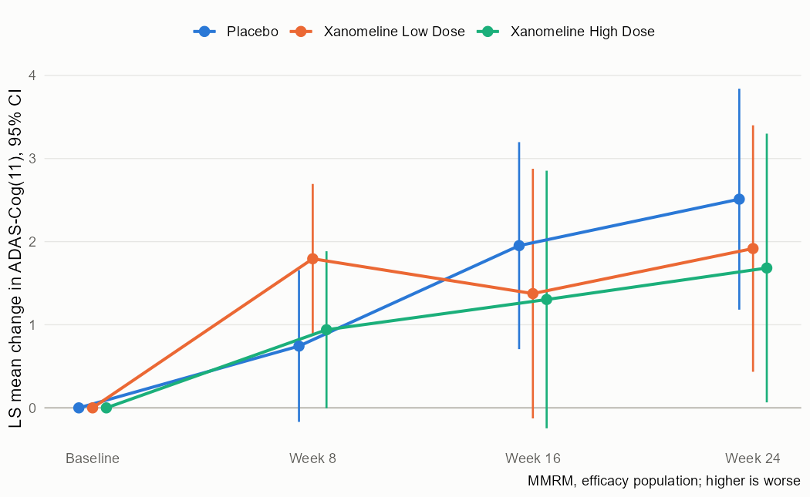
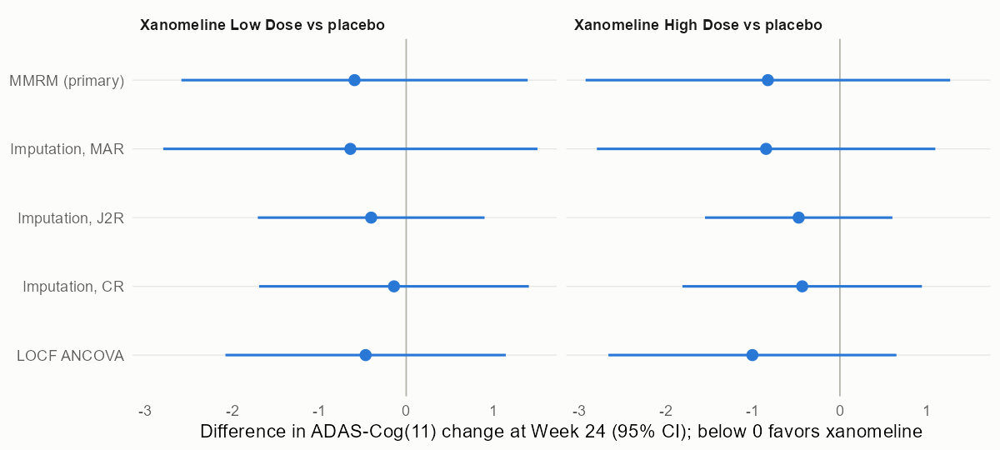

# Readout: ADAS-Cog(11) at Week 24 in the CDISC pilot study

The plan is in [sap.md](sap.md), including three amendments. Tables are in `tlf/`, figures in `figures/`, and every number below is in `results/`.

## Summary

Neither dose of xanomeline separated from placebo on ADAS-Cog(11) at Week 24. Under the primary hypothetical estimand, the MMRM difference from placebo was -0.83 points for the high dose (95% CI -2.92 to 1.27, p = 0.44) and -0.59 for the low dose (-2.59 to 1.40, p = 0.56). Because the high-dose test was not significant, the fixed-sequence procedure stops there, and the tipping-point analysis was not needed.

Missing data mattered more for the size of the estimate than for the conclusion. Treatment discontinuation was heavy in both active arms, mostly for adverse events (52% and 48% of patients against 9% on placebo), so about 40% of active-arm patients in the efficacy population had no Week 24 value against 18% on placebo. Assuming that patients who stopped an active dose then followed the placebo course (jump to reference) moved the high-dose estimate 43% closer to zero, to -0.47; carrying the last observation forward, the pilot's original approach, moved it away from zero, to -1.01, as expected when scores worsen over time and dropouts leave early. Every analysis had a confidence interval that included zero.

The analysis datasets were rebuilt from SDTM with admiral and checked against the pilot's own ADaM. All analysis records of ADAS-Cog, their baselines and changes, and every treatment-emergent flag matched. Of the 19 ADSL variables compared, 18 agreed for at least 95% of patients; baseline BMI agreed for 88.6%, because the pilot computed BMI from weight and height already rounded to one decimal.

## Quality control against the pilot ADaM

| Dataset | Result |
|---|---|
| ADSL, 254 patients, 19 variables | 15 variables identical for all patients; TRT01A 95.3%, TRTEDT 97.6%, WEIGHTBL 99.6%, BMIBL 88.6% |
| ADADAS, ADAS-Cog(11) analysis records | 794 of 794 present in both, with the same study day, value and baseline; change from baseline equal for all 540 post-baseline records |
| ADAS-Cog(11) total recomputed from the 11 items | equal to the collected total in 797 of 797 records with all items; the 21 records with missing items carry a non-integer total, consistent with prorating |
| ADAE treatment-emergent flag | 1,191 of 1,191 |

Every ADSL mismatch has a known cause (`results/qc_adsl_mismatches.csv`):
- TRT01A (12 patients): DM records the low dose as the actual arm of 12 patients randomized to the high dose, and the pilot sets actual treatment equal to planned. This project follows DM, so the safety tables have 96 low-dose and 72 high-dose patients.
- TRTEDT (6 patients): the pilot uses the date of the last visit when it is later than the last exposure record; 2 of the 6 have no end date on their last exposure record.
- WEIGHTBL (1 patient): this patient has no weight at the baseline visit, and the pilot leaves it missing; this project uses the screening weight, the last value before the first dose.
- BMIBL (29 patients): recomputing BMI from weight and height rounded to one decimal, as the pilot did, matches 253 of 254 patients.

## Code checks

| Check | Result |
|---|---|
| `mmrm` (Satterthwaite) vs `nlme::gls`, all contrasts and visits | largest differences 4.3e-6 in estimates and 1.4e-5 in standard errors |
| Conditional mean imputation under MAR + Week 24 ANCOVA vs MMRM, model without site | identical to 1.9e-14 |

The second check found an error before any sensitivity result was read: the first imputation model had no treatment-by-visit interaction (Amendment 2).

## Primary analysis

Efficacy population, 234 patients. Unstructured covariance converged.

| Arm | Patients | Week 24 observed | LS mean change (SE) | Difference vs placebo (95% CI) | p |
|---|---|---|---|---|---|
| Placebo | 79 | 65 | 2.51 (0.67) | | |
| Low dose | 81 | 49 | 1.92 (0.75) | -0.59 (-2.59, 1.40) | 0.557 |
| High dose | 74 | 41 | 1.68 (0.82) | -0.83 (-2.92, 1.27) | 0.437 |

## Sensitivity analyses

| Analysis | Low dose vs placebo | High dose vs placebo |
|---|---|---|
| MMRM, hypothetical (primary) | -0.59 (-2.59, 1.40) | -0.83 (-2.92, 1.27) |
| Imputation, MAR | -0.64 (-2.79, 1.51) | -0.85 (-2.80, 1.10) |
| Imputation, jump to reference | -0.40 (-1.71, 0.90) | -0.47 (-1.55, 0.60) |
| Imputation, copy reference | -0.14 (-1.69, 1.41) | -0.43 (-1.81, 0.94) |
| LOCF ANCOVA (pilot method) | -0.47 (-2.08, 1.15) | -1.01 (-2.66, 0.65) |

Correction: the first version of this readout gave Dunnett-adjusted intervals and p values for the MMRM and LOCF rows, because `emmeans` adjusts treatment-versus-control contrasts by default. The plan tests the two doses in a fixed sequence, so each comparison takes an unadjusted 95% interval; the rows above are the corrected ones (high dose MMRM was -3.21 to 1.55, p = 0.65). Estimates and every verdict are unchanged, and a test now checks that the intervals are unadjusted.

The reference-based intervals are narrower than the MAR interval. The jackknife gives a frequentist standard error, which under jump to reference shrinks along with the effect; this is a known property of reference-based imputation, not a gain in information.

## Predictions

| | Prediction | Result | Verdict |
|---|---|---|---|
| P1 | every ADSL variable agrees for at least 95% of patients, mismatches explained | BMIBL 88.6%, all explained | not met |
| P2 | recomputed total = collected total when all 11 items are present | 797 of 797 | met |
| P3 | `mmrm` and `gls` agree (1e-4, 1e-3) | 4.3e-6, 1.4e-5 | met |
| P4 | MAR imputation within 0.3 of the MMRM, high dose | 0.02 | met |
| P5 | J2R at least 20% closer to zero, high dose | 43% | met |
| P6 | LOCF more favorable to the high dose than the MMRM | -1.01 against -0.83 | met |

## Safety

Application-site and skin reactions were the most frequent treatment-emergent adverse events in the active arms: application site pruritus in 7% on placebo, 24% on the low dose and 29% on the high dose, and pruritus in 9%, 22% and 36% (Table 5, by actual treatment). Discontinuation for adverse events was 9%, 52% and 48% (Table 2). Signal detection, the timing of application-site reactions and subgroup analyses are in [readout_part2.md](readout_part2.md).

## Limits

The CDISC pilot data are a public demonstration data set, and this analysis plan is not the one the original study used. Discontinuation and study withdrawal coincide here, so no data after the intercurrent event exist, and a treatment-policy estimand can only be approximated by reference-based assumptions.
