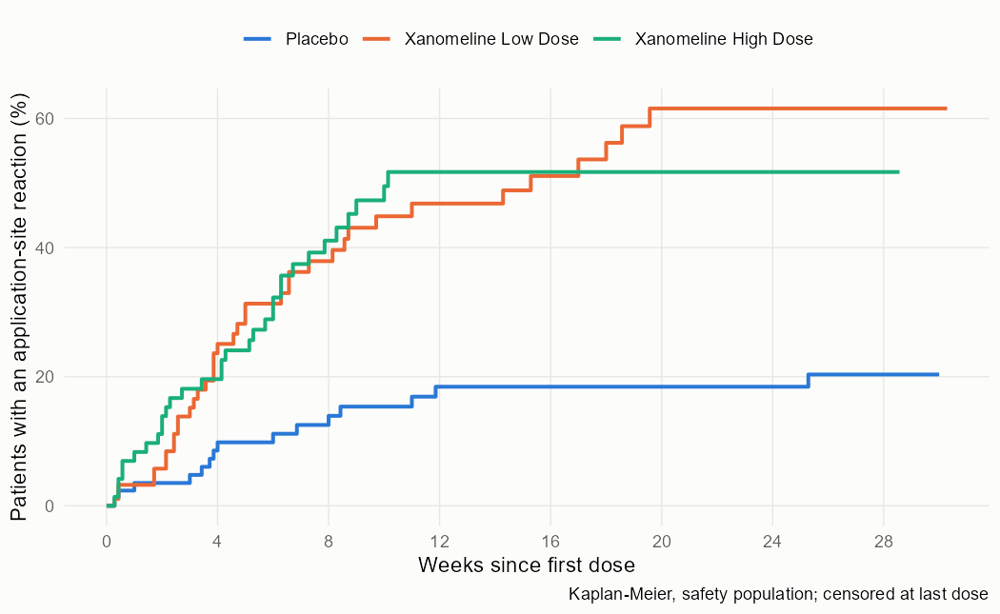
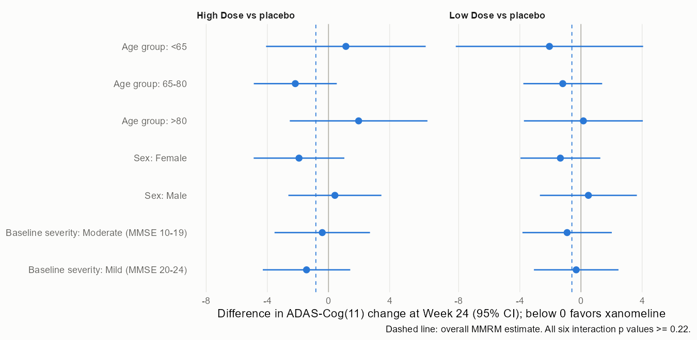

# Readout, part 2: safety signals and subgroups

The plan is [sap_part2.md](sap_part2.md), committed before any of these results were computed. Tables are `tlf/t6_signals.txt` and `tlf/t7_subgroups.txt`; every number below is in `results/`.

## Summary

Three adverse events stood out under every method: pruritus, application site pruritus and application site erythema, each at least three times as common on the high dose as on placebo. The three methods then disagreed on everything else. Across 186 preferred terms in the high-dose comparison, a crude screen at p < 0.05 flagged 8, the double false discovery rate flagged 3, and the Bayesian hierarchical model flagged 13. The double FDR dropped sinus bradycardia, hyperhidrosis and salivary hypersecretion, the slow heart rate, sweating and salivation expected from a muscarinic agonist such as xanomeline, and dizziness with them. The Bayesian model kept most of those, but it also raised terms with weak evidence of their own, such as fatigue (5 of 72 against 1 of 86, p = 0.09), because it borrows strength within a system organ class and MedDRA files fatigue with the application-site terms.

Application-site reactions began in the first weeks and kept accruing for about ten weeks on the high dose and twenty on the low dose. By Week 8, 41% of high-dose and 38% of low-dose patients had had one, against 14% on placebo. Of the patients who stopped an active dose for an adverse event, about 4 in 10 had a reaction before their last dose.

No subgroup changed the null primary result. All six interaction tests had p values between 0.22 and 0.79.

## Safety signal detection

Safety population by actual treatment (placebo 86, low dose 96, high dose 72), treatment-emergent events.

| Method | High dose vs placebo | Low dose vs placebo |
|---|---|---|
| Preferred terms compared | 186 | 182 |
| Crude screen, Fisher p < 0.05 | 8 | 3 |
| Double FDR, 0.1 and 0.1 | 3 | 1 |
| Bayesian hierarchical model, P(raised) >= 0.8 | 13 | 12 |

High dose against placebo, terms flagged by at least one method:

| Preferred term | High dose | Placebo | Risk difference, points (95% CI) | Fisher p | Double FDR | Bayes P |
|---|---|---|---|---|---|---|
| Pruritus | 36.1% | 9.3% | 26.8 (13.9, 39.2) | 0.0001 | flag | 1.00 |
| Application site pruritus | 29.2% | 7.0% | 22.2 (10.3, 34.1) | 0.0003 | flag | 1.00 |
| Application site erythema | 19.4% | 3.5% | 16.0 (6.2, 26.8) | 0.0015 | flag | 1.00 |
| Dizziness | 13.9% | 2.3% | 11.6 (3.1, 21.5) | 0.013 | | 0.99 |
| Application site irritation | 12.5% | 3.5% | 9.0 (0.5, 18.9) | 0.039 | | 0.99 |
| Salivary hypersecretion | 5.6% | 0% | 5.6 (0.1, 13.4) | 0.041 | | 0.71 |
| Sinus bradycardia | 11.1% | 2.3% | 8.8 (0.9, 18.2) | 0.044 | | 0.84 |
| Hyperhidrosis | 11.1% | 2.3% | 8.8 (0.9, 18.2) | 0.044 | | 0.99 |
| Erythema | 19.4% | 9.3% | 10.1 (-0.8, 21.7) | 0.105 | | 0.98 |
| Application site vesicles | 6.9% | 1.2% | 5.8 (-0.7, 14.1) | 0.093 | | 0.96 |
| Fatigue | 6.9% | 1.2% | 5.8 (-0.7, 14.1) | 0.093 | | 0.96 |
| Rash | 12.5% | 5.8% | 6.7 (-2.5, 16.8) | 0.167 | | 0.95 |
| Application site dermatitis | 9.7% | 5.8% | 3.9 (-4.7, 13.5) | 0.383 | | 0.88 |
| Skin irritation | 6.9% | 3.5% | 3.5 (-4.0, 12.1) | 0.470 | | 0.82 |

What the disagreement means:
- The double FDR spends its error budget at the level of system organ classes first. Three classes passed that step (skin, general and administration site, nervous system), each carried by its strongest term. Inside them, dizziness and hyperhidrosis did not survive the second correction among their classes' other terms (16 skin terms, for example). Sinus bradycardia and salivary hypersecretion never got a second look, because the cardiac and gastrointestinal classes failed the first step (adjusted p 0.19). The cholinergic terms share one mechanism but sit in four different classes, so a grouping by organ class cannot help them.
- The Bayesian model does the opposite: inside a class with a real signal it pulls related terms up. That helped rash and erythema, which are plausibly part of the same skin reaction, and it also lifted fatigue only because fatigue shares a class with the application-site terms. With a prior that expects about 80% of terms to have no effect and a 0.8 threshold, it flagged more terms than the crude screen, against prediction Q3.
- None of the methods is the answer. A safety reviewer would take the three agreed terms as established, read the cholinergic cluster as a mechanism-based signal worth following, and treat the borrowed flags (fatigue, application site dermatitis, skin irritation) as weak.

## Application-site reactions over time

Time from the first dose to the first application-site reaction (any preferred term starting with "Application site"), censored at the last dose.

| | Placebo | Low dose | High dose |
|---|---|---|---|
| Week 2 | 3.5% | 5.8% | 13.9% |
| Week 4 | 9.8% | 25.1% | 19.6% |
| Week 8 | 13.9% | 37.9% | 41.1% |
| Week 24 | 18.4% | 61.6% | 51.7% |
| Hazard ratio vs placebo (95% CI) | | 3.70 (2.03, 6.76) | 3.52 (1.90, 6.52) |
| Median day of onset, patients with a reaction | 28 (n = 15) | 30 (n = 38) | 29.5 (n = 32) |

The median high-dose onset was day 29.5, a day and a half past the 28 days of prediction Q4. The high-dose curve keeps rising until about Week 10 and the low-dose curve until about Week 20, so monitoring for skin reactions cannot stop after the first month. Discontinuation for adverse events was 9% on placebo (8 of 86), 51% on the low dose (49 of 96) and 49% on the high dose (35 of 72); 19 and 13 of those active-arm patients had an application-site reaction before their last dose. That is timing, not proof that the reaction caused the stop.

## Subgroups of the primary endpoint

| Subgroup | High dose vs placebo, Week 24 (95% CI) | Interaction p | Low dose vs placebo (95% CI) | Interaction p |
|---|---|---|---|---|
| Age <65 | 1.14 (-4.09, 6.36) | 0.22 | -2.06 (-8.19, 4.07) | 0.79 |
| Age 65-80 | -2.17 (-4.89, 0.54) | | -1.19 (-3.77, 1.39) | |
| Age >80 | 1.97 (-2.53, 6.47) | | 0.16 (-3.73, 4.05) | |
| Female | -1.93 (-4.90, 1.04) | 0.28 | -1.35 (-3.96, 1.27) | 0.38 |
| Male | 0.42 (-2.62, 3.46) | | 0.49 (-2.69, 3.66) | |
| Moderate, MMSE 10-19 | -0.41 (-3.53, 2.71) | 0.63 | -0.91 (-3.83, 2.02) | 0.77 |
| Mild, MMSE 20-24 | -1.44 (-4.30, 1.42) | | -0.31 (-3.08, 2.45) | |

The most favorable cell, high dose in patients aged 65 to 80 (-2.17, interval reaching 0.54), sits between two age groups that point the other way, and the test of differing effects gives p = 0.22. This is the pattern that gets over-read after a failed trial: with six tests, the chance of at least one p < 0.05 under no true difference is about one in four, and none occurred.

## Code checks

| Check | Result |
|---|---|
| V1. Newcombe interval, 56/70 vs 48/80 | 0.0524 to 0.3339, as published (tests/test_safety.R) |
| V2. Double FDR with one class equals Benjamini-Hochberg | equal (tests/test_safety.R) |
| V3. Simulated trial, 3 planted signals among 63 terms | 3 of 3 planted and 0 of 60 null terms flagged |

The fit on simulated data had 12 divergent transitions out of 8,000; the two fits on the trial data had none. Q6 covers the trial fits only.

## Predictions

| | Prediction | Result | Verdict |
|---|---|---|---|
| Q1 | application site pruritus and erythema flagged by all three methods, high dose | both flagged by all three | met |
| Q2 | double FDR flags fewer terms than the crude screen, high dose | 3 vs 8 | met |
| Q3 | Bayesian model flags fewer terms than the crude screen, high dose | 13 vs 8 | not met |
| Q4 | median onset of application-site reactions, high dose, at most 28 days | 29.5 days | not met |
| Q5 | no interaction p < 0.01, at most one p < 0.05 | smallest 0.22, none below 0.05 | met |
| Q6 | Stan fits: no divergences, R-hat < 1.01 | 0 divergences, largest R-hat 1.007 | met |

## Limits

Table T5 had been seen before this plan, so Q1 is not a test of discovery. Fisher's exact test is conservative for small counts, which makes the crude screen and the double FDR stricter than their nominal levels. The Bayesian results depend on the prior for the share of null terms and on MedDRA classes as the unit of borrowing; a grouping by mechanism would change which terms borrow from which. Safety tables follow actual treatment, which differs from randomized treatment for 12 patients.
